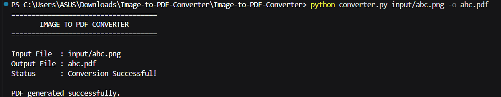
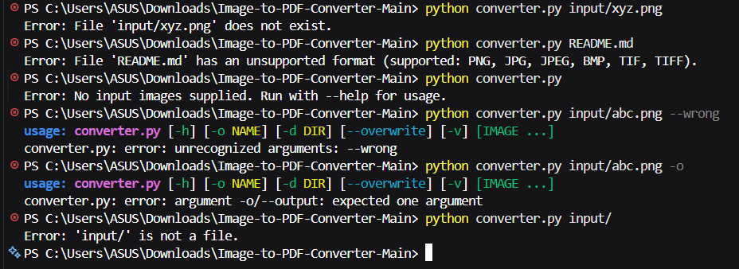

# Image to PDF Converter

A lightweight, GUI-free command-line tool that converts one or many images into
a PDF document. Written in Python 3 with [Pillow](https://python-pillow.org/)
as its only dependency. Works on Windows, Linux and macOS.

## Demo

### Application Output


## Features

- Convert a single image (`abc.png` -> `abc.pdf`)
- Combine several images into one PDF, one image per page
- Custom output file name (`-o`) and output directory (`-d`, created if missing)
- Validation: missing files, unsupported formats, corrupted/truncated images
- Never overwrites an existing PDF unless you pass `--overwrite`
- Original images are opened read-only and are never modified or deleted
- Aspect ratio always preserved; portrait and landscape images get matching A4 pages
- Transparent PNGs are flattened onto white, EXIF-rotated photos are shown upright,
  multi-page TIFFs become multiple PDF pages

**Supported formats:** PNG, JPG, JPEG, BMP, TIF, TIFF

## Installation

```bash
# 1. Get the project and open a terminal inside the folder
cd Image-to-PDF-Converter

# 2. (Optional) create a virtual environment
python -m venv .venv
source .venv/bin/activate          # Windows: .venv\Scripts\activate

# 3. Install the dependency
pip install -r requirements.txt
```

Requires Python 3.8 or newer. On some systems use `python3` instead of `python`.

## Usage

| Command | Description |
|---|---|
| `python converter.py abc.png` | Convert one image -> `abc.pdf` |
| `python converter.py a.png b.jpg c.jpeg` | Combine multiple images -> `converted.pdf` |
| `python converter.py abc.png -o result.pdf` | Specify output filename |
| `python converter.py abc.png -d output/` | Specify output directory |
| `python converter.py abc.png --overwrite` | Allow overwriting an existing PDF |
| `python converter.py abc.png -v` | Show detailed log messages |
| `python converter.py --help` | Display help |

Options can be combined: `python converter.py a.png b.jpg -o report -d pdfs/ --overwrite`
(`.pdf` is added automatically if you leave it off the name).

### Example output

```text
$ python converter.py input/abc.png -d output/
====================================
       IMAGE TO PDF CONVERTER
====================================

Input File  : input/abc.png
Output File : output/abc.pdf
Status      : Conversion Successful!

PDF generated successfully.
```

```text
$ python converter.py input/abc.png input/sample.jpg -d output/
====================================
       IMAGE TO PDF CONVERTER
====================================

2 images processed successfully.
Output PDF: output/converted.pdf
```

### Error messages

```text
$ python converter.py ghost.png
Error: File 'ghost.png' does not exist.

$ python converter.py abc.png          # abc.pdf already there
Error: Output file 'abc.pdf' already exists. Use --overwrite to replace it.
```

The exit code is `0` on success and `1` on any error, so the tool can be used in scripts.

### Error Handling



## Project structure

```text
Image-to-PDF-Converter/
├── converter.py         # entry point + argparse CLI
├── image_processor.py   # image validation, loading, RGB conversion
├── pdf_generator.py     # page layout and PDF writing
├── utils.py             # exceptions, path validation, output-path logic
├── requirements.txt
├── README.md
├── .gitignore
├── input/               # sample images (abc.png, sample.jpg)
├── screenshots/         # output screenshots (Error-handling.png, Help.png)
├── output/              # sample results (abc.pdf, converted.pdf)
└── tests/               # unit + end-to-end tests
```

## How it works

1. **Parse** (`converter.py`) - `argparse` reads the image paths and the options
   `-o`, `-d`, `--overwrite`, `-v`. No images -> a clear error.
2. **Validate every input first** (`image_processor.validate_image`) - the file must
   exist, be a regular file, have a supported extension and be readable. Pillow then
   runs `verify()` (structure check) and fully decodes the pixels, which catches
   truncated and corrupted files. If *any* image is bad, nothing is written.
3. **Resolve the output** (`utils.resolve_output_path`) - single image -> `<name>.pdf`;
   several images -> `converted.pdf`; `-o` overrides the name, `-d` the folder. The
   folder is created if needed, and an existing PDF is refused unless `--overwrite`
   is given. A PDF can never be written over one of the input images.
4. **Preprocess** (`image_processor.load_images`) - each image is opened read-only,
   rotated according to EXIF, and converted to RGB (transparency becomes white,
   16-bit/CMYK/palette/1-bit modes are handled). Multi-page TIFFs yield one image
   per frame.
5. **Lay out pages** (`pdf_generator.fit_to_page`) - every image goes on a white
   A4 page at 300 DPI: *portrait* page for portrait/square images, *landscape*
   page for wide images. It is scaled uniformly (never stretched) to fill the
   page minus a ~6 mm margin and centred.
6. **Write the PDF** (`pdf_generator.generate_pdf`) - Pillow saves all pages to a
   temporary file which is then atomically renamed to the final name, so a failure
   never leaves a half-written or destroyed PDF.

> **Quality note:** layout happens at 300 DPI (print quality). Images larger than
> the A4 area are scaled down slightly, and pages are embedded as high-quality
> JPEG (quality 95). The source files themselves are never touched.

## Running the tests

Tests use only the standard library (`unittest`):

```bash
python -m unittest discover -s tests -t . -v
```

They cover image validation (valid/missing/unsupported/corrupted/truncated files),
colour-mode handling, page layout and aspect ratio, PDF generation, output-path
rules, overwrite protection and the complete CLI.

## Troubleshooting

- **`ModuleNotFoundError: No module named 'PIL'`** - run `pip install -r requirements.txt`.
- **Permission denied** - choose a different folder with `-d`, or check folder rights.
- **GIF/WebP/other formats** - not in the supported list; convert them to PNG/JPG first.
